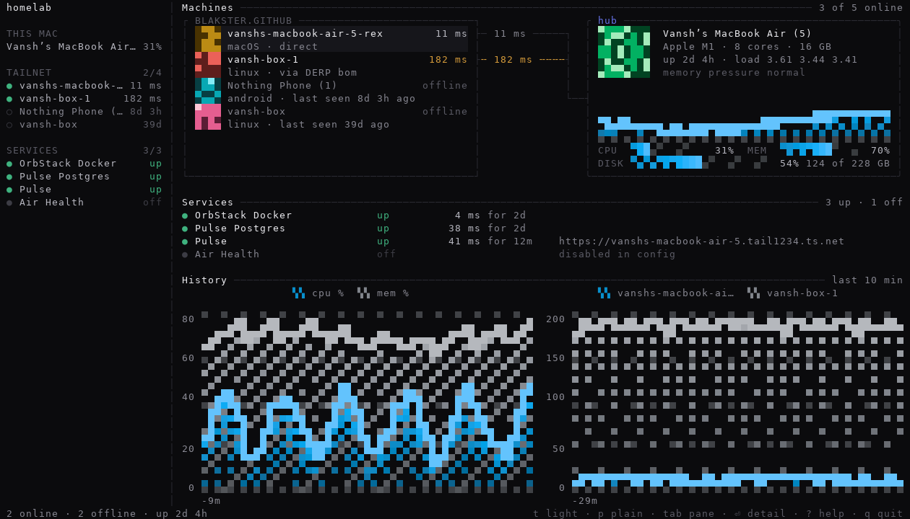
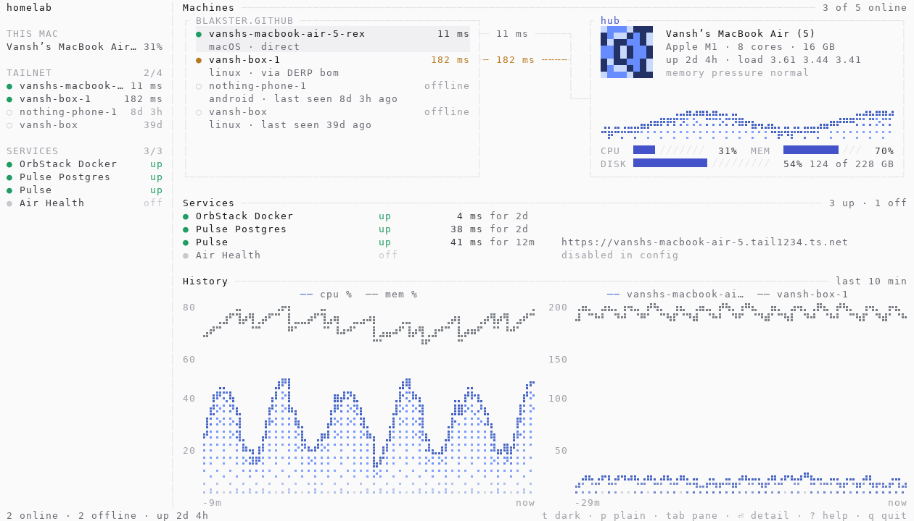
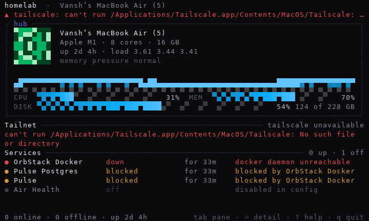

# homelab

A dithered terminal dashboard for a Mac and its tailnet. It shows which machines are online, how each one is reached (direct or through a DERP relay, with latency), and whether your services are healthy. When something breaks, it names the root cause. You reach it from any device on your tailnet with plain `ssh`, so there's no web app, no open port, and no password.



<details><summary>Light theme, and an 80-column fault view</summary>




</details>

Built with [Ratatui](https://ratatui.rs) and [Dither Kit for Ratatui](https://github.com/DeepanshuMishraa/dither-kit-rs) (half-block truecolor charts, meters and avatars). Inspired by [@capythanh's strawhat](https://x.com/capythanh).

## What it shows

- **Machines.** The tailnet as a topology: this Mac as the hub, peers with their OS, and each edge marked direct or relayed (`via DERP bom`) with ping latency. Offline peers show when they were last seen.
- **Services.** HTTP, TCP, Docker container and Docker daemon checks. Dependencies are modelled, so when OrbStack is down, Postgres and the app show *blocked by OrbStack* instead of three separate alarms. A service that was up only turns red after two failed probes in a row. Disabled services stay listed as `off` and never count as faults.
- **This Mac.** CPU, memory (the same active + wired + compressed number Activity Monitor uses), memory pressure, disk, load and uptime, plus a 10-minute history.

## Remote access

```
phone / laptop ──ssh -p 2222──▶ tailscale serve (tcp) ──▶ 127.0.0.1:2222 homelab serve
```

`homelab serve` is a small SSH server ([russh](https://github.com/Eugeny/russh)) that only accepts public keys listed in `~/.config/homelab/authorized_keys`. Each session gets its own dashboard sized to that terminal. There's no shell, no `exec`, no subsystems and no forwarding: `ssh host cat /etc/passwd` gets a one-line refusal and exit status 1. The server binds to loopback only, and Tailscale makes it reachable from your tailnet and nowhere else.

```sh
ssh -p 2222 you@your-mac.your-tailnet.ts.net
```

Keys: `j/k` move · `tab` switch pane · `⏎` details · `t` light/dark · `p` plain (ANSI-16, no truecolor) · `?` help · `q` quit.

## Install (macOS)

You need Rust 1.95 or newer (`rustup`), Tailscale, and optionally OrbStack or Docker for container checks.

```sh
git clone https://github.com/blakster/homelab && cd homelab
scripts/install-macos.sh --tailscale
```

The script is safe to re-run. It:

1. Builds a release binary and installs it to `~/.local/bin/homelab`.
2. Writes `~/.config/homelab/config.toml` from `config.example.toml`, but only if no config exists yet.
3. Seeds `~/.config/homelab/authorized_keys` from `~/.ssh/*.pub`, but only if that file doesn't exist yet.
4. Loads the launchd agent `dev.blakster.homelab` (RunAtLoad, KeepAlive), which logs to `~/Library/Logs/homelab.log`.
5. With `--tailscale`, runs `tailscale serve --bg --tcp 2222 tcp://127.0.0.1:2222`. Your other serve routes are left alone.

To remove it, run `scripts/uninstall-macos.sh`. Add `--purge` to also delete `~/.config/homelab`.

You can also run `homelab` with no arguments for a local dashboard in the current terminal.

## Configure

```toml
[[service]]
id = "pulse-db"
name = "Pulse Postgres"
check = { kind = "docker", container = "pulse-dev-db" }
depends_on = ["orbstack"]

[[service]]
id = "pulse"
name = "Pulse"
url = "https://your-mac.your-tailnet.ts.net"
check = { kind = "http", url = "http://127.0.0.1:3001/healthz" }
depends_on = ["pulse-db"]

[[service]]
id = "air-health"
name = "Air Health"
check = { kind = "http", url = "http://127.0.0.1:4870/healthz" }
enabled = false   # listed as "off", never a fault
```

Check kinds: `http` (optional `expect` status), `tcp` (`addr`), `docker` (`container`), and `docker-daemon`. Unknown fields, duplicate ids and unknown dependencies are errors at startup. See [`config.example.toml`](config.example.toml).

## Architecture

```
collectors ──Update──▶ hub (single writer) ──watch<Arc<Snapshot>>──▶ local TUI
  host     every 2s                                               ├▶ SSH session (own Terminal + UiState)
  tailscale status 10s, ping 30s                                  ├▶ SSH session …
  health   every 5s                                               └▶ render / snapshot --json
```

- `model.rs`: the `Snapshot` and its types. States are enums, so "relayed but unmeasured" or "blocked but up" can't be represented.
- `collect/`: host metrics (sysinfo + `vm_stat` and sysctl on macOS), `tailscale status --json` and `tailscale ping`, and service probes with a two-strike tracker and dependency resolution.
- `hub.rs`: a pure `apply(snapshot, update)` plus the collection schedule.
- `ui/`: a pure `render(area, buf, &Snapshot, &UiState)`. Every frontend calls it: the local TUI, each SSH session, and the `render` command used for the screenshots above.
- `ssh.rs`: the SSH server.

## Development

```sh
cargo test                                         # unit, snapshot (insta) and SSH end-to-end tests
cargo run -- --data demo                           # fixture data; also: worst, empty, one, 1000, error, loading
cargo run -- --data worst render --width 50 --height 30
cargo run -- --data demo render --width 140 --height 40 --cells | python3 scripts/screenshot.py out.png
```

Fixtures go through the same `Snapshot` boundary as live data, and "now" is pinned, so renders are deterministic. Each data set is snapshot-tested at 50, 80, 120 and 200 columns. Release builds (`--no-default-features`) leave out the fixtures and the `--data` flag. The design rules are in [`.interface-design/system.md`](.interface-design/system.md).

## License

MIT
